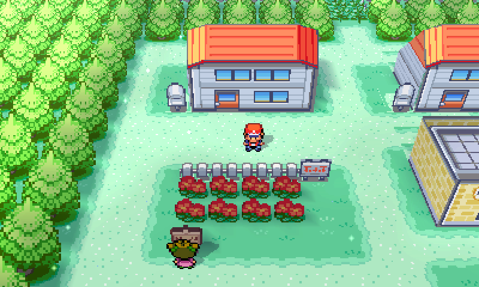
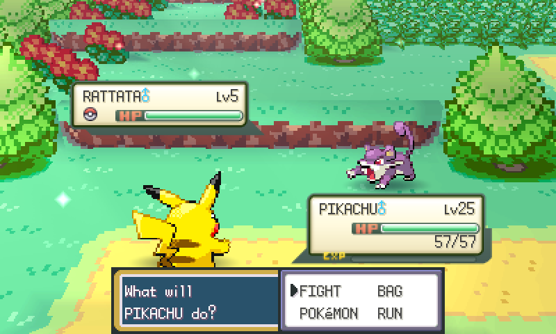
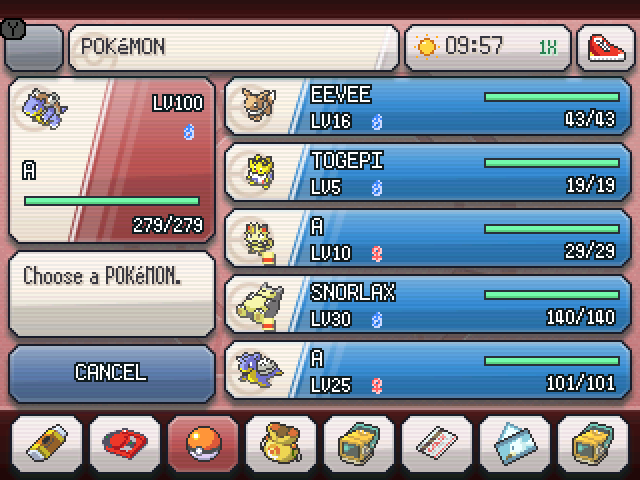

# FireRed Evolved

FireRed Evolved expands the original Kanto adventure on Game Boy Advance.
The current release package is **v0.2.42**. The GBA build remains **v0.2.36**; this package adds FireRed Evolv3D installation, updates, photo mode and a quest journal. [Open the free web patcher](https://niceliketryce.github.io/FireRed-Evolved/).

## Major features

- **Postgame Gen3 support** — Trade Gen3 Pokémon and legal held items after Celio’s Ruby/Sapphire quest; restore incense breeding and National Dex entries.

- **All 251 Pokémon** — Catch and collect every Gen 1 and Gen 2 species on one save, including LeafGreen exclusives.
- **Bigger battle rewards** — Earn bonus items, stronger TMs, and unlocks from Gyms and major battles.
- **RNG Fix** — Uses Ruby and Sapphire’s clock-based startup seeding.
- **Walking partners** — Bring any of the 386 species along, including shiny variants after the normal postgame unlocks.
- **Battle Frontier** — Challenge seven facilities with link battles, recordings, and original Emerald music.
- **Secret Bases** — Find 28 entrances, decorate your base, and visit and battle in other bases.
- **Celadon Contests** — Compete in five categories and four ranks for ribbons and paintings.
- **Pokéblocks** — Blend berries with NPCs or link partners, then feed your Pokémon.
- **Berry gardening** — Plant, water, and harvest berries in 22 beds using the Goldeen Canteen.

- **Reward progress** — See exact Mew/Celebi catch totals, missing species and habitats.
- **Save backups** — Keep five recent backups per trainer and preview before restoring.
- **Offline builder** — Prepare a verified offline pack, then build either edition without a connection.

## Minor features

- **A changing world** — Real-time day and night and weather change Kanto's scenery.
- **Habitat Guide** — Look up Pokémon locations, encounter odds, levels, and unlock conditions.
- **Training tools** — Check IVs and EVs, reuse longer Repels, and hatch eggs faster with Magma Armor or Flame Body.
- **Easier evolutions** — Use Bill's trade-backs, Sun and Moon Stones for Eevee, and missed-move learning.
- **Tree Shaker** — Find encounters in trees, inspired by Gen 2 Headbutt.
- **Safari Zone** — Catch all three Johto starters.
- **Sevii encounters** — Find the original FireRed rosters, plus an activated Gen 2 roster in Altering Cave.
- **Wild odds** — Listed rare encounters have 5%; nighttime grass and trees reserve 5% for Gastly and 1% for Haunter, with remaining odds shared evenly.
- **Berry Forest** — Ground berries respawn in half the usual steps.
- **Bookcase hints** — Search bookcases for Gen 2 Pokémon locations.
- **Early gifts** — Find a Lucky Egg, Bill's Eevee, and FLASH from Lt. Surge.
- **Acro Bike** — Hop ledges in either direction after becoming Champion.
- **Mirage Island** — Follow Mom's hint to a new ferry destination after becoming Champion.
- **Legendary encounters** — See roaming beasts in grass and retry legendary encounters until you catch them.

Reward milestones and RNG tool notes

- **Gym rewards** — Leaders give bonus items and stronger TMs. Brock gives Secret Power.
- **Normal Elite Four** — Unlock the Battle Frontier, Acro Bike, legendary beasts, Sudowoodo, second fossil and Dojo Pokémon, and Leftovers for Jaime's Toasted Tea quest.
- **Hard Elite Four** — Unlock Oak's Challenge. Winning earns the Mystic Ticket for Navel Rock and its Ho-Oh and Lugia encounters.
- **Catch #1–150** — Meet Mew under the truck.
- **Catch #1–250** — Receive Oak's Gen Sync GS Ball to catch Celebi on Faraway Island.
- **PokeFinder** — The documented compatible methods are eggs, gifts, and Gen 1 static encounters. Wild and Gen 2 static encounters use different methods.

## Move your save

Use the [save transfer tool](https://niceliketryce.github.io/FireRed-Evolved/save.html) to move between GBA and 3DS, or import an original US/English FireRed battery save. Each package includes an untouched backup. Read the [controls and save guide](https://niceliketryce.github.io/FireRed-Evolved/guide.html).

## How to play

1. Bring your own clean US/English FireRed v1.0 or v1.1 ROM.
2. Open the [free web patcher](https://niceliketryce.github.io/FireRed-Evolved/) and select your ROM.
3. Choose **Patch and download**, then open the patched file in your GBA emulator.

Both base revisions produce the same game. Your ROM stays on your device.
For offline patching, get the matching BPS from [Releases](https://github.com/NiceLikeTryce/FireRed-Evolved/releases/latest).

[Full feature list](FEATURES.txt) · [Report a bug or get help](https://github.com/NiceLikeTryce/FireRed-Evolved/issues)

## Gameplay gallery

For the 3DS edition, follow the [HOME Menu QR and wireless installation guide](https://niceliketryce.github.io/FireRed-Evolved/install.html).
